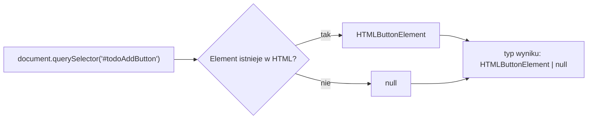
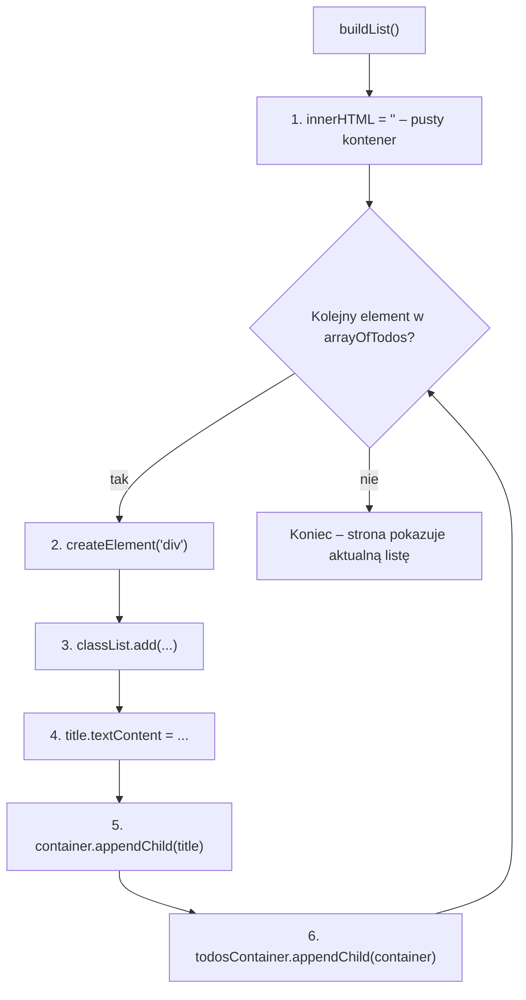
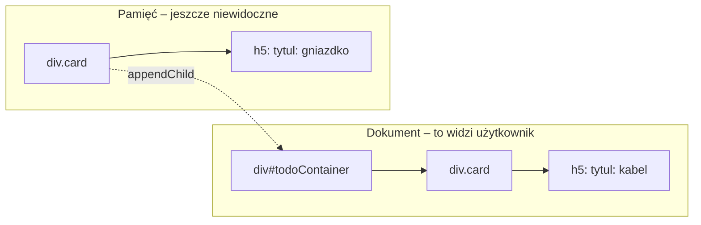

# Temat: Praca z DOM – `null`, `!`, `as`

## Pobieranie elementów
`document.querySelector()` i `document.getElementById()` szukają elementu w drzewie DOM.
Jeśli elementu nie ma (literówka w id, skrypt uruchomiony przed załadowaniem HTML), zwracają **`null`**.
TypeScript o tym wie, dlatego typ wyniku zawsze zawiera `| null`.

```ts
const addButton: HTMLButtonElement | null = document.querySelector("#todoAddButton");
```



Kompilator nie pozwoli użyć takiej zmiennej bez sprawdzenia:
```ts
addButton.addEventListener("click", ...);    // BŁĄD: 'addButton' is possibly 'null'

if (addButton) {
  addButton.addEventListener("click", ...);  // OK – wewnątrz if typ to HTMLButtonElement
}

addButton?.addEventListener("click", ...);   // OK – optional chaining: gdy null, nic się nie dzieje
```

## Operator `!` – non-null assertion
```ts
const todosContainer: HTMLDivElement = document.querySelector("#todoContainer")!;
```
`!` na końcu wyrażenia mówi kompilatorowi: **„wiem, że to nie jest `null`”**. Usuwa `null` z typu.

> Uwaga: `!` działa tylko w czasie kompilacji. W wygenerowanym JavaScripcie znika.
> Jeśli element jednak nie istnieje, program wywali się przy pierwszym użyciu zmiennej:
> `TypeError: Cannot set properties of null`.

## Asercja typu – `as`
```ts
const pole = (id: string) => document.getElementById(id) as HTMLInputElement;

const nazwa = pole("nazwa").value;   // .value istnieje tylko w HTMLInputElement
```
`getElementById` zwraca ogólny `HTMLElement | null`, który nie ma pola `value`.
`as HTMLInputElement` mówi kompilatorowi: **„traktuj to jako pole input”**.
Podobnie jak `!` – to tylko informacja dla kompilatora, nic nie jest sprawdzane w trakcie działania.

| Zapis | Co robi |
|---|---|
| `x \| null` | typ uwzględnia brak elementu – musimy to obsłużyć |
| `x?.metoda()` | wywołaj tylko, gdy `x` nie jest `null`/`undefined` |
| `x!` | „to na pewno nie `null`” |
| `x as Typ` | „to na pewno jest `Typ`” |

## Budowanie listy w DOM
```ts
function buildList() {
  todosContainer.innerHTML = "";              // 1. wyczyść kontener

  arrayOfTodos.forEach(element => {
    let container = document.createElement("div");   // 2. utwórz element
    container.classList.add("card-body", "card", "shadow"); // 3. dodaj klasy CSS

    let title = document.createElement("h5");
    title.textContent = "tytul: " + element.title;   // 4. wpisz tekst

    container.appendChild(title);             // 5. włóż tytuł do karty
    todosContainer.appendChild(container);    // 6. włóż kartę na stronę
  });
}
```



Dopóki nie wykonamy kroku 6, karta istnieje tylko w pamięci – tak jak kartka wypisana, ale nieprzypięta do tablicy.



### Co się stanie, gdy usuniemy któryś krok?
- **Bez `todosContainer.innerHTML = ""`** – każde wywołanie `buildList()` dopisuje całą listę od nowa pod starą. Po dodaniu trzeciego zadania na stronie widać 1 + 2 + 3 = 6 kart – elementy się **duplikują**.
- **Bez `todosContainer.appendChild(container)`** – karty są tworzone w pamięci, ale nigdy nie trafiają do dokumentu. **Lista na stronie jest pusta**, choć tablica zawiera dane.

### `textContent` a `innerHTML`
- `textContent` wstawia czysty tekst – bezpieczne dla danych od użytkownika.
- `innerHTML` interpretuje HTML – wpisanie `` jako tytułu wykona kod (XSS).
  Do czyszczenia kontenera (`innerHTML = ""`) jest w porządku.

## Pytania kontrolne
1. Dlaczego typ `addButton` zawiera `| null`?
2. Co oznacza `!` na końcu `document.querySelector("#todoContainer")!`?
3. Do czego służy `as HTMLInputElement`?
4. Co stanie się z listą po usunięciu `todosContainer.innerHTML = ""`?
5. Co stanie się po pominięciu `todosContainer.appendChild(container)`?
