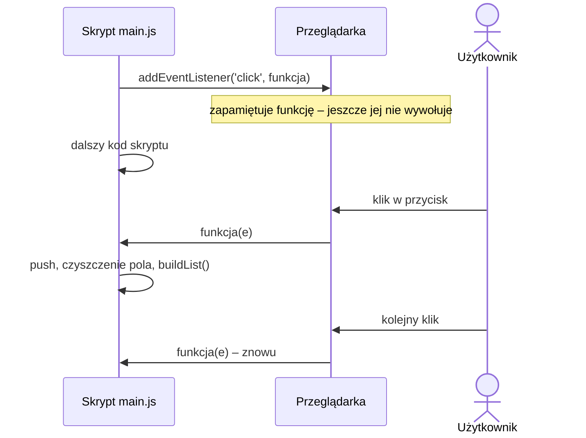

# Temat: Zdarzenia – `addEventListener`

## Rejestracja obsługi zdarzenia
```ts
addButton?.addEventListener('click', (e) => {
  arrayOfTodos.push({ id: arrayOfTodos.length, title: inputTextField.value });
  inputTextField.value = '';
  buildList();
});
```

`addEventListener(typ, funkcja)` przyjmuje:
- **typ zdarzenia** – np. `'click'`, `'input'`, `'submit'`, `'keydown'`,
- **funkcję obsługi** (callback) – tu funkcja strzałkowa `(e) => { ... }`.

### Kiedy wykona się funkcja?
**Nie** w momencie wykonania linii `addEventListener` – wtedy funkcja jest tylko *zapamiętywana* (rejestrowana).
Przeglądarka wywoła ją **za każdym razem, gdy użytkownik kliknie przycisk**. Pięć kliknięć = pięć wywołań.



```ts
console.log("1");
addButton?.addEventListener('click', () => console.log("klik"));
console.log("2");
// konsola od razu: 1, 2
// "klik" pojawi się dopiero po kliknięciu
```

Jeśli `addButton` jest `null`, operator `?.` sprawia, że nasłuchiwanie w ogóle nie zostanie dodane – kliknięcia nic nie zrobią, a w konsoli nie będzie błędu.

## Obiekt zdarzenia `e`
Parametr `e` (typ `MouseEvent` dla `'click'`) zawiera informacje o zdarzeniu:
```ts
form.addEventListener('submit', (e) => {
  e.preventDefault();          // nie przeładowuj strony po wysłaniu formularza
  console.log(e.target);       // element, który wywołał zdarzenie
});
```

## Atrybuty `data-*` i `dataset`
Przy przyciskach generowanych w pętli wygodnie jest zapisać w nich identyfikator:
```ts
const przycisk = document.createElement("button");
przycisk.dataset.ean = produkt.ean;           // w HTML: <button data-ean="590...">
przycisk.addEventListener("click", () => {
  console.log(przycisk.dataset.ean);
});
```

## Pytania kontrolne
1. Kiedy zostanie wykonana funkcja strzałkowa przekazana do `addEventListener`?
2. Co się stanie, gdy `addButton` będzie `null`?
3. Do czego służy `e.preventDefault()`?
