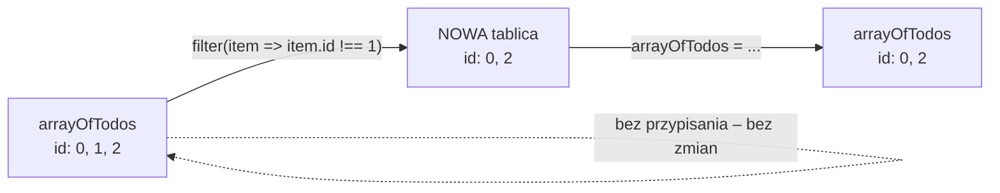

# Temat: Operacje na tablicach – `push`, `filter`, `find`

## `push` – dodanie elementu
Modyfikuje tablicę **w miejscu**.
```ts
arrayOfTodos.push({ id: 3, title: "kabel" });
```

## `filter` – usuwanie elementów
```ts
arrayOfTodos = arrayOfTodos.filter((item) => item.id !== element.id);
```
`filter` **nie zmienia** oryginalnej tablicy. Zwraca **nową** tablicę z elementami, dla których funkcja zwróciła `true`.
Dlatego wynik trzeba przypisać z powrotem – inaczej element „usunie się” tylko w nowej tablicy, którą od razu wyrzucamy.

```ts
arrayOfTodos.filter(item => item.id !== 2);                // nic się nie zmieni
arrayOfTodos = arrayOfTodos.filter(item => item.id !== 2); // element o id 2 znika
```
Zmienna musi być zadeklarowana przez `let`, nie `const` – przypisujemy do niej nową wartość.



## `find` – wyszukanie jednego elementu
```ts
const p = produkty.find((x) => x.ean === przycisk.dataset.ean);
if (!p) return;
```
`find` zwraca **pierwszy** pasujący element albo **`undefined`**, gdy nic nie pasuje.
Typ wyniku to `Produkt | undefined`, więc kompilator wymaga sprawdzenia `if (!p) return;` przed użyciem `p`.

| Metoda | Zwraca | Zmienia oryginał? |
|---|---|---|
| `push(x)` | nową długość | tak |
| `filter(fn)` | nową tablicę (może być pusta) | nie |
| `find(fn)` | element albo `undefined` | nie |
| `findIndex(fn)` | indeks albo `-1` | nie |
| `map(fn)` | nową tablicę tej samej długości | nie |
| `forEach(fn)` | nic (`undefined`) | nie |

## Problem z identyfikatorem `id = length`
```ts
arrayOfTodos.push({ id: arrayOfTodos.length, title: inputTextField.value });
```

| Krok | Tablica (id) | `length` |
|---|---|---|
| dodaj A | `[0]` | 1 |
| dodaj B | `[0, 1]` | 2 |
| dodaj C | `[0, 1, 2]` | 3 |
| usuń A (id 0) | `[1, 2]` | 2 |
| dodaj D → `id = 2` | `[1, 2, 2]` | 3 |

Zadania C i D mają to samo `id`. Usunięcie jednego z nich (`filter` po `id`) usunie **oba**, a edycja może trafić w niewłaściwy element.

### Rozwiązanie – osobny licznik
```ts
let nextId = 0;
arrayOfTodos.push({ id: nextId++, title: inputTextField.value });
```
lub unikalny identyfikator:
```ts
id: Date.now()              // liczba milisekund
// albo dla typu string:
id: crypto.randomUUID()
```

## Pytania kontrolne
1. Dlaczego wynik `filter` przypisujemy z powrotem do `arrayOfTodos`?
2. Jaki problem z `id` powstanie po dodaniu trzech zadań, usunięciu pierwszego i dodaniu kolejnego?
3. Co zwróci `find`, gdy żaden produkt nie ma podanego kodu EAN?
