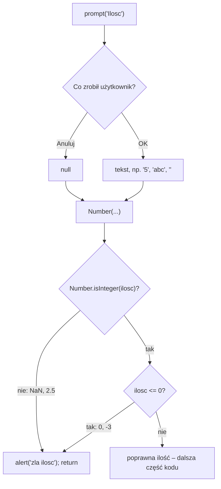

# Temat: Dane od użytkownika – `prompt`, `Number`, walidacja

## `prompt`
```ts
let newTitle = prompt("Zmień nazwę produktu:", element.title);
if (newTitle !== null) { element.title = newTitle; }
```
`prompt(komunikat, wartośćDomyślna)` wyświetla okno z polem tekstowym. Typ wyniku: **`string | null`**.

| Akcja użytkownika | Wynik |
|---|---|
| wpisał tekst i OK | wpisany tekst, np. `"kabel"` |
| wyczyścił pole i OK | pusty string `""` |
| **Anuluj** lub **Esc** | **`null`** |

Sprawdzenie `newTitle !== null` odróżnia „użytkownik zrezygnował” od „użytkownik coś wpisał”.
Zwróć uwagę: pusty string `""` przejdzie ten warunek – jeśli nie chcemy pustych nazw, dopisz `&& newTitle.trim() !== ""`.

## Zamiana tekstu na liczbę – `Number`
```ts
const ilosc = Number(prompt("Ilosc (" + rodzaj + "):"));
if (!Number.isInteger(ilosc) || ilosc <= 0) { alert("zla ilosc"); return; }
```
`prompt` **zawsze** zwraca tekst (lub `null`). `"5"` to nie to samo co `5`:
```ts
"5" + 1        // "51"  – sklejenie tekstów
Number("5") + 1 // 6
```

### Jak działa `Number`
| Wejście | `Number(...)` | `Number.isInteger(...)` |
|---|---|---|
| `"12"` | `12` | `true` |
| `"2.5"` | `2.5` | `false` |
| `"abc"` | `NaN` | `false` |
| `""` | `0` | `true` (ale odrzuci `<= 0`) |
| `null` (Anuluj) | `0` | `true` (ale odrzuci `<= 0`) |



Warunek `!Number.isInteger(ilosc) || ilosc <= 0` odrzuca więc tekst, ułamki, zero, liczby ujemne i anulowanie okna.

### `Number` a `parseInt`
```ts
Number("12abc")    // NaN  – cały tekst musi być liczbą
parseInt("12abc")  // 12   – czyta od początku, dopóki są cyfry
```
Do walidacji bezpieczniejszy jest `Number`.

## Pytania kontrolne
1. Dlaczego wynik `prompt` przekazujemy do `Number`?
2. Kiedy `prompt` zwróci `null`?
3. Co zwróci `Number("abc")` i jak to wykryć?
