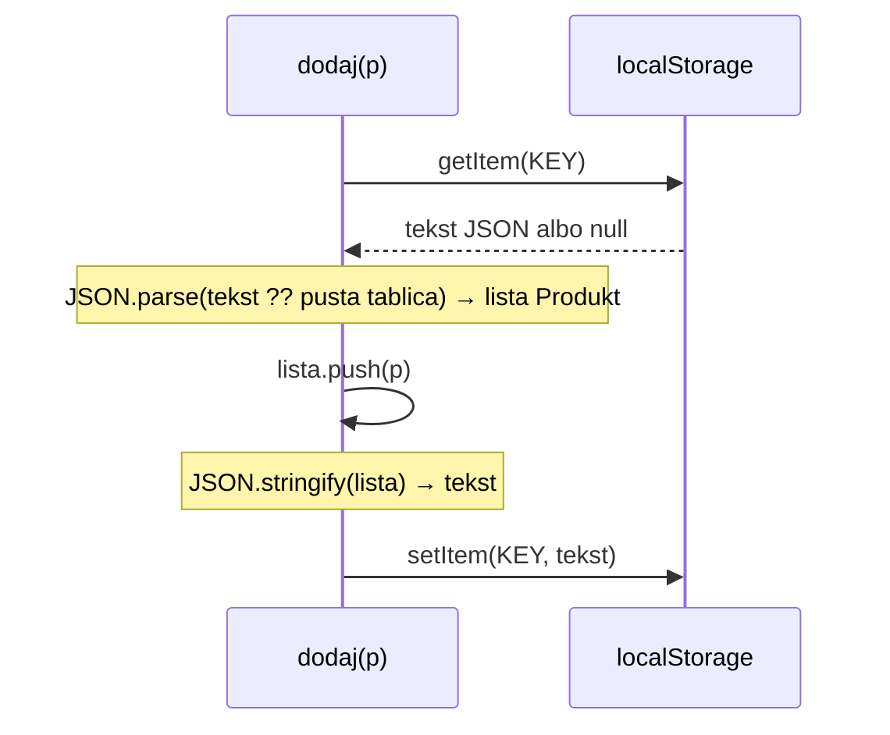

# Temat: Zapis danych w przeglądarce – `localStorage`

## Czym jest `localStorage`?
Magazyn klucz → wartość w przeglądarce. Dane **zostają po odświeżeniu strony i zamknięciu przeglądarki**.
Są przypisane do domeny (adresu strony) i przechowują **wyłącznie tekst**.

```ts
localStorage.setItem("klucz", "wartość");   // zapis
localStorage.getItem("klucz");              // odczyt → string | null
localStorage.removeItem("klucz");           // usunięcie jednego klucza
localStorage.clear();                       // usunięcie wszystkiego
```

`getItem` zwraca `null`, gdy klucza jeszcze nie ma (pierwsze uruchomienie).

## Zapisywanie obiektów – JSON
Obiektu ani tablicy nie da się zapisać bezpośrednio – trzeba je zamienić na tekst:
```ts
JSON.stringify([{ id: 1, nazwa: "kabel" }])  // '[{"id":1,"nazwa":"kabel"}]'
JSON.parse('[{"id":1,"nazwa":"kabel"}]')      // z powrotem tablica obiektów
```

> Bez `JSON.stringify` zapis `localStorage.setItem(KEY, lista)` zapisze tekst `"[object Object]"`.

## Funkcja `dodaj`
```ts
type Produkt = { id: number, nazwa: string };
const KEY = "produkty";

function dodaj(p: Produkt): void {
  const lista: Produkt[] = JSON.parse(localStorage.getItem(KEY) ?? "[]"); // 1. odczyt
  lista.push(p);                                                          // 2. dopisanie
  localStorage.setItem(KEY, JSON.stringify(lista));                       // 3. zapis
}
```


- `?? "[]"` – gdy `getItem` zwróci `null` (brak danych), użyj pustej tablicy. Bez tego `JSON.parse(null)` zwróci `null` i `push` wywali błąd.
- Odczyt → zmiana → zapis całej listy: `localStorage` nie umie dopisać elementu do istniejącej wartości.

## Funkcje pomocnicze
```ts
function wczytaj(): Produkt[] {
  return JSON.parse(localStorage.getItem(KEY) ?? "[]");
}

function zapisz(lista: Produkt[]): void {
  localStorage.setItem(KEY, JSON.stringify(lista));
}

function usun(id: number): void {
  zapisz(wczytaj().filter(p => p.id !== id));
}
```

## Podgląd danych
DevTools (F12) → zakładka **Application** (Chrome/Edge) lub **Storage** (Firefox) → **Local Storage**.

## Pytania kontrolne
1. Jakiego typu wartości przechowuje `localStorage`?
2. Po co `JSON.stringify` i `JSON.parse`?
3. Co zwróci `localStorage.getItem(KEY)` przy pierwszym uruchomieniu aplikacji?
4. Napisz funkcję `dodaj(p: Produkt): void`, która dopisuje produkt do listy zapisanej pod kluczem `KEY`.
